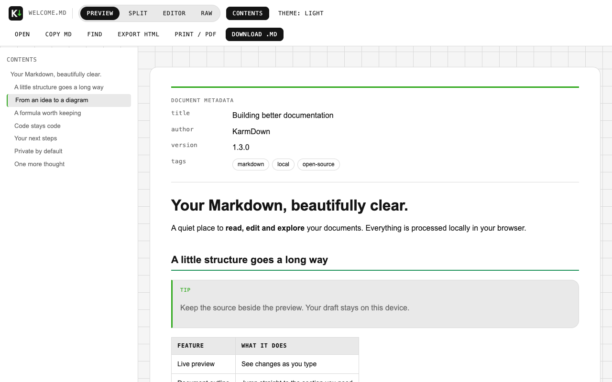
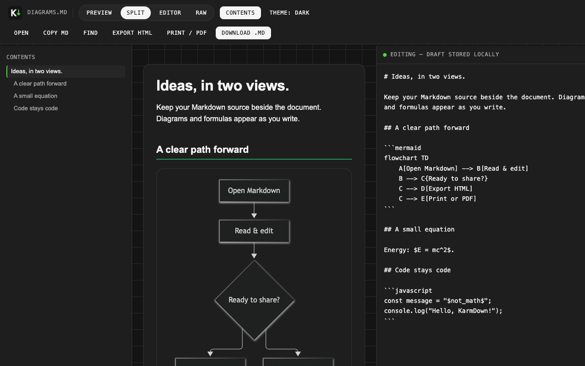

<div align="center">
  
  <h1>KarmDown</h1>
  <p><strong>Your Markdown, beautifully clear.</strong></p>
  <p>A local Markdown viewer and editor for Chrome.<br>Read, edit, search and export — without accounts or document uploads.</p>
  <p><a href="https://github.com/solosenkov/karmdown/releases/latest">Download</a> · <a href="PRIVACY.md">Privacy</a> · <a href="https://github.com/solosenkov/karmdown/issues">Feedback</a></p>
  <p>  </p>
</div>



## Made for documents, not distractions

- **Four views:** Preview, Split, Editor and Raw, with live preview as you type.
- **Local drafts:** recover your edits, remember your reading position, download the Markdown when ready.
- **Live reload:** follow changes to an opened local file. If you have edited the document, a conflict banner preserves your draft until you explicitly load the disk version.
- **Find in the preview:** highlight matches, jump forward/backward, and see a match count.
- **Frontmatter:** view simple YAML-style metadata and tags above the document. Nested values stay literal; this is intentionally not a full YAML parser.
- **Rich Markdown:** GFM tables, task lists, GitHub alerts, highlighted code, Mermaid diagrams and KaTeX math.
- **Export:** a styled HTML file with embedded math fonts and diagrams, or a PDF through your browser's print dialog.
- **Your reading space:** light/dark/system themes, reading width, font size, document outline and instant settings updates.
- **English by default**, with a Russian interface available in the popup.

All rendering libraries are bundled locally. No CDN, telemetry, account or subscription. Remote document images are blocked by default.



## Install the release

Chrome Web Store publication is pending. You can already install the release manually:

1. Download `karmdown-1.3.0-chrome.zip` from [Releases](https://github.com/solosenkov/karmdown/releases/latest) and extract it.
2. Open `chrome://extensions` and enable **Developer mode**.
3. Click **Load unpacked** and choose the extracted folder containing `manifest.json`.
4. For automatic local-file preview, open KarmDown's **Details** and enable **Allow access to file URLs**.
5. Open `file:///path/to/README.md` in Chrome.

You can also use **Open Markdown file** in the popup. That opens an extension-owned viewer and does not require access to file URLs.

For a raw Markdown document on HTTP/HTTPS, press **Alt+Shift+M** to activate the viewer. Press it again to switch Raw ↔ Preview. Ordinary HTML pages are left untouched. Chrome may reserve a shortcut on your system; change it at `chrome://extensions/shortcuts`.

## Small details that matter

| Action | Shortcut |
| --- | --- |
| Find in the rendered document | `/` outside the editor, or `Ctrl/Cmd+Shift+F` |
| Next / previous match | `Enter` / `Shift+Enter` in the search field |
| Close search | `Esc` |
| Download Markdown | `Ctrl/Cmd+S` |
| Toggle Raw / Preview | `Alt+Shift+M` |

Saving downloads a file; it does not overwrite your original file. Local relative images work for documents opened directly through `file://`. A file picker grants access to that file only, so neighboring images cannot be resolved automatically. HTML exports embed local images when readable; explicitly enabled remote images remain external URLs.

Settings use Chrome Sync when enabled. Drafts and reading positions stay in `chrome.storage.local`. Use **Clear local drafts** in the popup to remove them. See the [privacy policy](PRIVACY.md) for details.

## Build and verify

Node.js 22+ and Python 3 are required for development; neither is needed to use the extension.

```sh
npm ci --ignore-scripts
npm run check
npm audit
npx playwright-core install chromium
npm run verify:browser
npm run build
```

The ZIP is generated from an explicit runtime allowlist. It excludes private documentation, tests, build tools, screenshots, dependencies and OS files. Bundled libraries are pinned and checksummed; their complete notices are in [THIRD_PARTY_NOTICES.md](THIRD_PARTY_NOTICES.md).

See [contributing](CONTRIBUTING.md) and [security](SECURITY.md). KarmDown source is [MIT licensed](LICENSE); third-party assets retain their original licenses.

## По-русски

KarmDown — расширение для просмотра и редактирования Markdown в Chrome. Есть оглавление, поиск, локальные черновики, автообновление файлов, диаграммы, формулы и экспорт HTML/PDF. Язык по умолчанию — английский; русский выбирается в popup.

Для локальных файлов включите **«Разрешить открывать локальные файлы по ссылкам»** в настройках расширения. Сохранение скачивает `.md`, а не перезаписывает исходник. Документы не отправляются разработчику; внешние картинки по умолчанию заблокированы.
