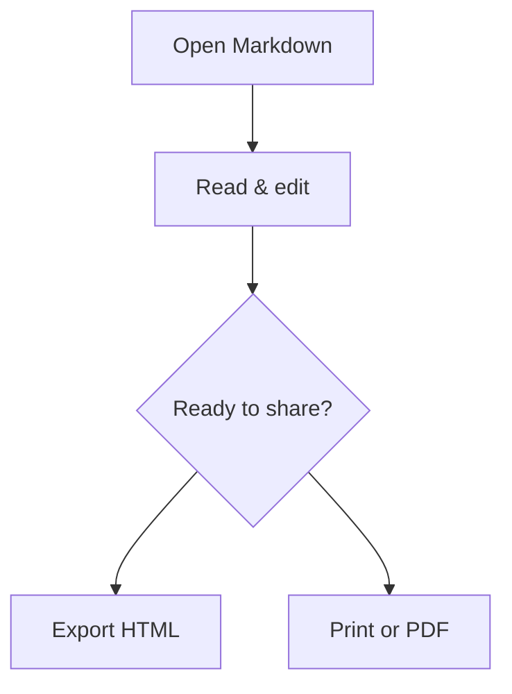

# Ideas, in two views.

Keep your Markdown source beside the document. Diagrams and formulas appear as you write.

## A clear path forward



## A small equation

Energy: $E = mc^2$.

## Code stays code

```javascript
const message = "$not_math$";
console.log("Hello, KarmDown!");
```
