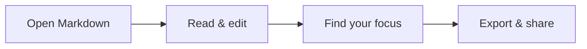

# Your Markdown, beautifully clear.

A quiet place to **read, edit and explore** your documents. Everything is processed locally in your browser.

## A little structure goes a long way

> [!TIP]
> Keep the source beside the preview. Your draft stays on this device.

| Feature | What it does |
| --- | --- |
| Live preview | See changes as you type |
| Document outline | Jump straight to the section you need |
| Search | Find every mention of Markdown |
| Export | Take a clean HTML or PDF copy |

## From an idea to a diagram



## A formula worth keeping

Energy: $E = mc^2$.

$$
\int_{-\infty}^{\infty} e^{-x^2}\,dx = \sqrt{\pi}
$$

## Code stays code

```javascript
const message = "$not_math$";
console.log("Hello, KarmDown!");
```

## Your next steps

- [x] Open a Markdown document
- [x] Enjoy a clean preview
- [ ] Make it your own

## Private by default

No accounts. No analytics. No document uploads. Remote images stay blocked until you choose to enable them.

## One more thought

Markdown is portable. Your documents belong to you.
